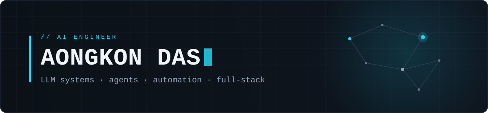

<p align="center">
  
</p>

```yaml
name: Aongkon Das
role: AI Engineer & Full-Stack Developer
focus:
  - LLM gateways & agentic workflows
  - AI-assisted product development
  - full-stack web & mobile apps
currently_building: ai-proxy-server
```

## Selected work

| Project | Overview | Stack |
| --- | --- | --- |
| [**ai-proxy-server**](https://github.com/Aongkon29/ai-proxy-server) | Serverless DeepSeek LLM gateway plus a multi-agent satellite-tracking assistant (capstone). | `Python` `Vercel Edge` `Google ADK` `MCP` |
| [**daily-lagbe-mobile**](https://github.com/Aongkon29/daily-lagbe-mobile) | React Native / Expo e-commerce app with published APK releases. | `TypeScript` `React Native` `Expo` |
| [**daily-lagbe**](https://github.com/Aongkon29/daily-lagbe) | Client e-commerce storefront, built and delivered end to end. | `HTML` `JavaScript` `Python` |
| [**hsk-vocab**](https://github.com/Aongkon29/hsk-vocab) | HSK Chinese vocabulary learning app. | `HTML` `Python` |

## Stack

**Languages** — `Python` `TypeScript` `JavaScript` `HTML/CSS`

**Ship** — `React Native` `Expo` `Vercel` `Git`

**AI** — `DeepSeek API` `Google ADK` `MCP`

## Currently

> Building `ai-proxy-server` — a serverless DeepSeek gateway and a multi-agent satellite-tracking assistant. Open to AI engineering and full-stack collaborations.
